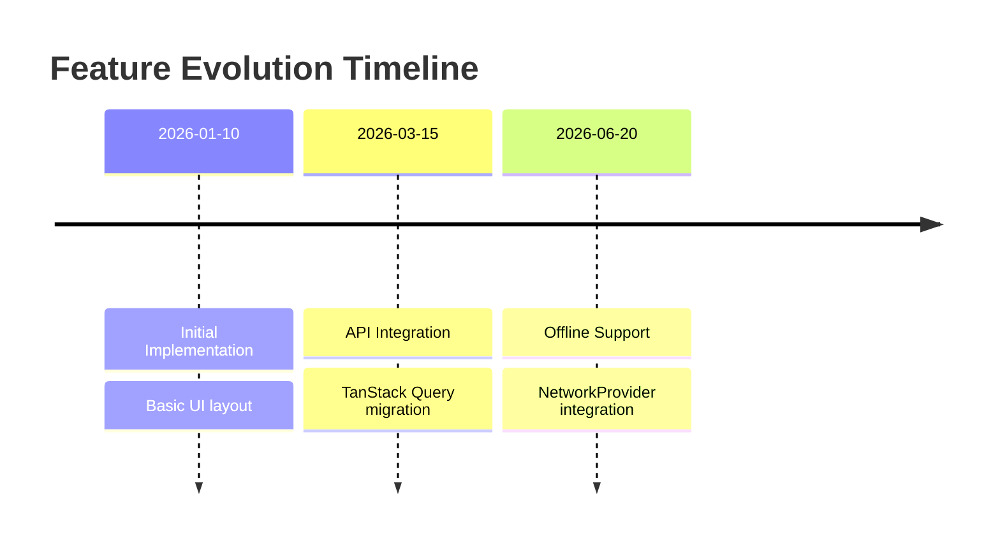

# Git History Documenter

A specialized skill for inspecting Git commit histories, analyzing commit diffs and messages, extracting architectural context, and generating clear, structured change timelines for project documentation.

## When to use this skill

- Analyzing previous Git commits, tags, branches, or date ranges to understand code evolution.
- Generating a **Change Timeline** or **Changelog** for project documentation (e.g. in `docs/` or `CHANGELOG.md`).
- Investigating historical context behind complex changes, refactors, or feature rollouts.
- Summarizing the commit history of specific files, directories, or subsystems.
- Writing Architecture Decision Records (ADRs) or technical docs based on historical commit evidence.

## Do not use this skill when

- Making new uncommitted code edits without analyzing prior commit history.
- Performing routine file search or codebase navigation unrelated to Git commit history (use `codebase-exploration` instead).

---

## Workflow Instructions

Follow this structured 5-step process when executing Git history analysis and creating change timelines.

### Step 1: Scope Identification

Determine the target boundary for the historical analysis:
1. **Commit Range / Boundary**: Single commit hash, range (e.g., `HEAD~10..HEAD`, `v1.0.0..HEAD`), branch comparison (`main..feature`), or timeframe (`--since="2 weeks ago"`).
2. **File or Subsystem Scope**: Specific file path (e.g. `Screens/Tips/index.tsx`), directory (e.g. `Components/`), or entire workspace.
3. **Documentation Target**: Determine where the result will be written (e.g. `docs/CHANGE_TIMELINE.md`, `docs/FEATURE_EVOLUTION.md`, or updating existing markdown docs).

### Step 2: History & Diff Extraction

Use non-interactive `run_command` shell executions to query Git. Always ensure `PAGER=cat` is set or output is limited to avoid paging blocks.

```bash
# 1. High-level list of commits with short hashes and dates
git log --pretty=format:"%h | %ad | %an | %s" --date=short -n 20

# 2. View summary of changed files per commit
git log --stat -n 10

# 3. Track full file rename/move history
git log --follow --stat -- <file_path>

# 4. Detailed diff of specific commit(s)
git show <commit_hash>

# 5. Diff between two commits or branches for specific files
git diff <commit_A>..<commit_B> -- <file_path>
```

> [!TIP]
> Combine `--stat` with `--oneline` for quick broad analysis before diving into heavy `git show` diffs.

### Step 3: Change Analysis & Categorization

Examine commit diffs and messages to uncover:
- **Core Intent**: Why was the change made? (Refactor, Bug Fix, Feature, Performance, Security, Integration).
- **Architectural Impact**: Were core abstractions, state management, routes, or API contracts altered?
- **Dependencies**: Were new packages added or updated?
- **Breaking Changes**: Did prop structures, function signatures, or data shapes change?
- **Context & Decisions**: Uncover rationale recorded in commit messages, PR tags, or inline comments.

### Step 4: Structuring the Timeline & Documentation

Draft the documentation using clean GitHub-flavored markdown. Include:
1. **Executive Summary**: Overview of what changed and why across the scope.
2. **Change Timeline**: Chronological table or formatted list detailing commit date, hash, author, category, and summary.
3. **Deep-Dive Breakdown**: Detailed narrative of major milestones or architectural shifts.
4. **Impacted Files & Symbols**: Clickable markdown file links (`file:///...`) to affected source files.

### Step 5: Persistence & Verification

1. Write or update the documentation file in `docs/` using `write_to_file` or `replace_file_content`.
2. Verify that all file links, line ranges, and commit hashes are accurate.
3. Present the resulting documentation summary to the user.

---

## Output Templates

### Template 1: Change Timeline (`docs/CHANGE_TIMELINE.md`)

```markdown
# Change Timeline & History Log

**Scope**: `[Commit Range / Subsystem Name]`  
**Date Generated**: `YYYY-MM-DD`  
**Analyzed Commits**: `[Count]`

## Overview

[Brief summary of the changes, architectural decisions, and key milestones captured in this analysis.]

## Chronological Timeline

| Date | Commit | Category | Summary | Impacted Component |
| :--- | :--- | :--- | :--- | :--- |
| YYYY-MM-DD | [`a1b2c3d`](file:///path/to/repo) | 🚀 Feature | Added user authentication flow | Auth / Navigation |
| YYYY-MM-DD | [`e5f6g7h`](file:///path/to/repo) | ⚡ Refactor | Migrated storage to TanStack Query | API / State |
| YYYY-MM-DD | [`i8j9k0l`](file:///path/to/repo) | 🐛 Fix | Resolved race condition on offline probe | Context / Network |

## Detailed Breakdown

### Milestone 1: [Feature or Refactor Name]

- **Commit**: `a1b2c3d`
- **Date**: YYYY-MM-DD
- **Author**: [Author Name]
- **Category**: [Feature / Refactor / Bug Fix / Breaking Change]

#### Summary of Changes
[Description of what was implemented or changed.]

#### Technical Impact & Rationale
- **Rationale**: [Why this change was necessary]
- **Key Code Modifications**:
  - [`Screens/Tips/index.tsx`](file:///absolute/path/to/Screens/Tips/index.tsx) - [What changed]
  - [`Utils/Colors.ts`](file:///absolute/path/to/Utils/Colors.ts) - [What changed]

#### Potential Risks / Follow-ups
- [Note any risks or required follow-ups]
```

### Template 2: Feature Evolution Log (`docs/FEATURE_EVOLUTION.md`)

```markdown
# Feature Evolution: [Feature / Subsystem Name]

## Subsystem Overview
- **Primary Files**: [`Screens/Tips/index.tsx`](file:///absolute/path/to/Screens/Tips/index.tsx)
- **First Introduced**: YYYY-MM-DD (`commit_hash`)
- **Last Updated**: YYYY-MM-DD (`commit_hash`)

## Major Milestones



### Change History Details

#### Phase 1: Initial Implementation (`commit_hash`)
- Created base UI components and navigation stack entries.
- Set up state hooks and localized constants.

#### Phase 2: Refactoring & Optimizations (`commit_hash`)
- Optimized re-renders and added offline fallback handling.
- Unified dark mode color tokens with [`Utils/Colors.ts`](file:///absolute/path/to/Utils/Colors.ts).
```

---

## Best Practices & Guidelines

1. **Always use exact file links**: Format links to source files using GitHub-style markdown file links (`[file basename](file:///absolute/path/to/file)`).
2. **Never guess commit details**: Execute `git log` and `git show` to obtain exact commit hashes, dates, authors, and diff details before drafting documentation.
3. **Group by logical changes**: When dealing with many small commits (e.g. "fix typo", "lint fix"), group related commits under a unified milestone or task in the timeline rather than listing noise.
4. **Highlight Breaking & Architectural Changes**: Explicitly tag any changes that affect public signatures, database schemas, environment variables, or global providers.
5. **Keep Docs Synchronized**: If updating repository docs, place new timelines in `docs/` alongside existing documentation files.
